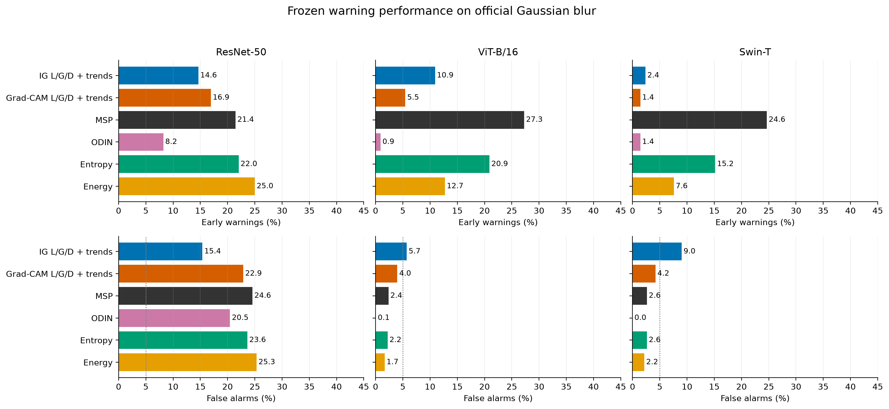
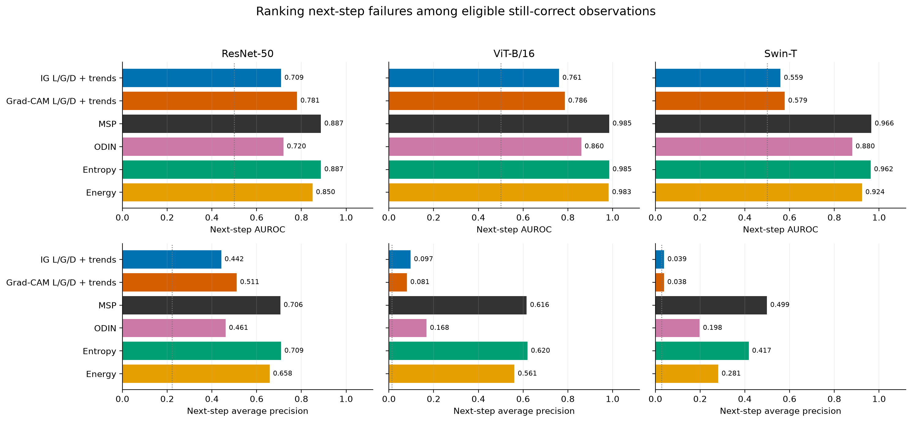
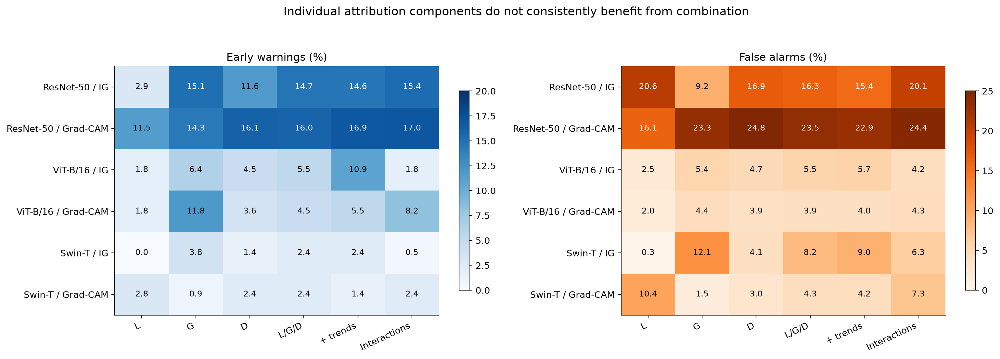
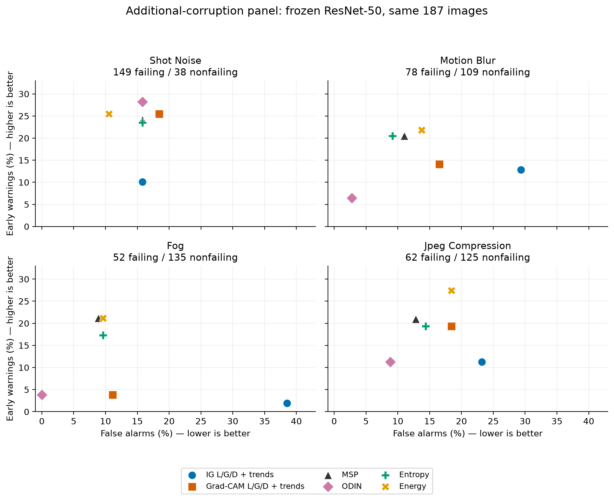

# Attribution-Based Failure Detection Under Distribution Shift

This completed project asks whether changes in attribution maps warn of image-classification failure earlier or more reliably than output-based confidence scores.

**Main finding:** the evaluated attribution-only warning methods did not demonstrate a consistent advantage over confidence baselines under official CIFAR-10-C corruption shift. Some component ablations and individual corruption cases show different tradeoffs; they do not establish universal superiority or universal failure of attribution methods.

Start with the [final figures and tables](results/reporting/final/README.md), [study specification](docs/FINAL_STUDY.md), and [script reading guide](docs/CODE_GUIDE.md).

## Results at a glance

The final report contains **four figures and three tables** across ResNet-50, ViT-B/16, and Swin-T. Models were calibrated on Gaussian noise/brightness and evaluated with frozen thresholds on official Gaussian blur.

### Early warnings and false alarms



Higher warning sensitivity and lower false alarms are preferable. The dotted 5% line is the development calibration target; it is not a guaranteed test false-alarm rate.

### Main comparison snapshot

Primary attribution detectors and the MSP confidence baseline are shown below. Warning rates use failing trajectories; false alarms use nonfailing trajectories. AUROC ranks next-step first failures among eligible still-correct observations.

| Classifier | Method | Early warnings (%) | False alarms (%) | Next-step AUROC |
|---|---|---:|---:|---:|
| ResNet-50 | IG L/G/D + trends | 14.64 | 15.38 | 0.709 |
| ResNet-50 | Grad-CAM L/G/D + trends | 16.94 | 22.89 | 0.781 |
| ResNet-50 | MSP | 21.45 | 24.58 | 0.887 |
| ViT-B/16 | IG L/G/D + trends | 10.91 | 5.71 | 0.761 |
| ViT-B/16 | Grad-CAM L/G/D + trends | 5.46 | 3.99 | 0.786 |
| ViT-B/16 | MSP | 27.27 | 2.37 | 0.985 |
| Swin-T | IG L/G/D + trends | 2.37 | 9.01 | 0.559 |
| Swin-T | Grad-CAM L/G/D + trends | 1.42 | 4.21 | 0.579 |
| Swin-T | MSP | 24.64 | 2.63 | 0.966 |

[Full six-method comparison, including ODIN, entropy, Energy, lead steps, and average precision →](results/reporting/final/table2_main_comparison.md)

### Ranking next-step failures



Confidence baselines generally rank failures more effectively in this study, especially on the transformer classifiers. These are descriptive results; no statistical superiority is asserted.

<details>
<summary><strong>Attribution-component ablations</strong> — L, G, D, combinations, and trends</summary>



Combining components does not consistently improve the sensitivity/false-alarm tradeoff. The two heatmaps use different color scales. [Complete ablation table →](results/reporting/final/table3_component_ablations.md)

</details>

<details>
<summary><strong>Additional-corruption generalization</strong> — shot noise, motion blur, fog, and JPEG</summary>



This exploratory extension uses the same 187 valid ResNet-50 images across four corruptions, with frozen models and thresholds. Upper-left indicates a preferable tradeoff. It is a smaller ResNet-only panel. [Findings and limitations →](results/additional_corruption_smoke/FINDINGS.md)

</details>

### Evaluation cohorts

| Classifier | Valid development images | Valid test images | Failing test trajectories | Nonfailing test trajectories |
|---|---:|---:|---:|---:|
| ResNet-50 | 4745 | 1885 | 1352 | 533 |
| ViT-B/16 | 4940 | 1965 | 110 | 1855 |
| Swin-T | 4799 | 1920 | 211 | 1709 |

Each architecture started with 5,000 development and 2,000 test candidates; valid cohorts differ by clean correctness and map validity. [Full cohort table →](results/reporting/final/table1_cohorts.md) · [All figures, tables, and detailed captions →](results/reporting/final/README.md)

## GitHub contents

This repository contains code, configuration, and study documentation. The four final report figures (PNG/PDF) and three Markdown summary tables are included for browsing. Datasets, model weights, split CSVs, raw experiment outputs, other generated figures, and the presentation binary remain local and are excluded by `.gitignore`. Links to excluded artifacts describe the full local project; rebuilding reports requires the saved evaluation files, which are not included here.

## Final study

- Frozen published CIFAR-10 **ResNet-50, ViT-B/16 and Swin-T** checkpoints.
- Official pre-generated **CIFAR-10-C**, severity 0–5; 0 is the corresponding clean image.
- **5000 development candidates**, Gaussian noise and brightness; **2000 additional test candidates**, Gaussian blur. Actual clean-correct/common-valid image counts vary by architecture.
- **Integrated Gradients (64 steps)** and **Grad-CAM** generate maps for the fixed clean predicted class.
- Attribution Loss **L**, Attribution Gain **G**, retention-weighted Wasserstein distance **D** and their adjacent-severity changes feed separate attribution-only logistic classifiers.
- Primary IG/Grad-CAM L/G/D+trend models; combined static and pairwise-interaction ablations; supplementary **L alone, G alone, D alone** for both map generators.
- Baselines: **MSP, ODIN, predictive entropy, Energy**, with confidence trends as an additional control. Entropy/Energy and individual components were added as documented supplements.
- Models and preprocessing fitted on development fitting groups; thresholds calibrated on separate image groups, targeting 5% nonfailing-trajectory alarms, then frozen before test evaluation. Achieved test false alarms can differ.
- A supplementary frozen **ResNet-50** panel evaluates shot noise, motion blur, fog and JPEG compression on the same 187 valid images. It is an exploratory extension, not another three-architecture benchmark.

Logistic regression is the secondary **classification** model; the image classifiers are not fine-tuned. No confidence feature enters attribution-only warning models. Pearson/cosine, sparse encodings, projections, clustering and alarm-filter experiments are archived and excluded from the final method.

## Results to use

| Location | Role |
|---|---|
| [results/reporting/final/](results/reporting/final/README.md) | Four figures, three tables, captions and source hashes |
| `results/expanded_cifar10c_5000dev_2000test/` | Authoritative expanded data, maps, frozen models, evaluations and supplements |
| [results/additional_corruption_smoke/](results/additional_corruption_smoke/FINDINGS.md) | Additional-corruption panel and complete outcomes |
| `results/final_cifar10c/` | Only precursor development manifest and locked protocol retained for expanded setup; superseded outputs removed |
| `results/validation/`, `figures/archive/historical_validation/` | Historical attribution-validation evidence; provenance limits apply |

## Rebuild the final report

```bash
MPLCONFIGDIR=/tmp/asws-final-mpl .venv/bin/python -m scripts.build_final_results
```

This reads saved evaluation files; it does not rerun classifiers, fit models or tune thresholds. Each figure is PNG/PDF and each table is CSV/Markdown/LaTeX. See [metrics](docs/METRICS_GUIDE.md) and [presentation order](docs/PRESENTATION_GUIDE.md).

See [the documentation index](docs/README.md) for the final guides. [Code synchronization](docs/CODE_SYNC.md) distinguishes the cleaned local tree from the earlier Rivanna version. Historical sources and records are archived; restoring their original paths/bytes is necessary before guarded historical reruns. Completed results are unchanged.
